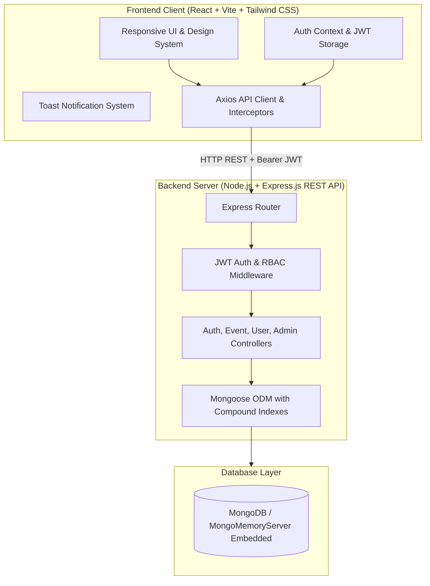

# 🪔 UtsavLocal — Bengaluru Local Event & Festival Aggregator
> **3rd-Semester Computer Science & Engineering Community Engagement Project**  
> *Connecting Bengaluru residents to neighborhood cultural festivals, artisan workshops, indie recitals, and civic drives across Namma Ooru.*

---

## 📌 Project Overview
Bengaluru is a vibrant mosaic of historic cultural traditions and thriving modern grassroots communities. While mega commercial concerts and mall expos dominate conventional ticketing platforms, neighborhood residents often miss out on iconic local events — such as the 500-year-old **Kadalekayi Parishe in Basavanagudi**, classical twilight Veena concerts in **Malleshwaram**, community lake cleanups at **Sankey Tank**, Sunday book swaps in **Cubbon Park**, and artisan terracotta pottery workshops in **Indiranagar**.

**UtsavLocal** solves this discovery gap by providing a high-performance, mobile-first, and culturally vibrant community aggregator platform where:
- **Citizens** discover upcoming weekend gatherings, search by neighborhood, bookmark events, and RSVP with 1 click.
- **Event Organizers & Cultural Trusts** submit neighborhood festivals, track attendee counts, and manage event schedules.
- **Community Admins & Student Moderators** review and approve submissions in real time to prevent spam and ensure verified local gatherings.

---

## ⚡ 1-Click Streamlit Cloud Deployment

UtsavLocal is fully configured for **Streamlit Community Cloud** (`share.streamlit.io`):
- **Entry File:** `app.py`
- **Dependencies:** `requirements.txt`
- **Theme Config:** `.streamlit/config.toml`

### Deploy on Streamlit in 3 Steps:
1. Go to [share.streamlit.io](https://share.streamlit.io) and sign in with GitHub.
2. Click **"New app"** and select:
   - **Repository:** `praj937/UtsavLocal`
   - **Branch:** `main`
   - **Main file path:** `app.py`
3. Click **"Deploy!"** — Your app goes live with live Bengaluru events, search, filters, persona switching, and admin moderation!

To test Streamlit locally:
```bash
python -m streamlit run app.py
```

---

## 🏛️ System Architecture & Tech Stack



### 1. Frontend (`/client`)
- **Core:** React 18 with Vite for ultra-fast HMR and bundle compilation.
- **Styling:** Tailwind CSS with custom Karnataka cultural palette (warm terracotta `#EA580C`, amber `#D97706`, and clean slate cards).
- **Navigation:** React Router DOM v6 with route-level role-based guards (`ProtectedRoute`).
- **Icons:** Lucide React for consistent, crisp iconography.
- **Network:** Axios client configured with automatic JWT authorization header injection.

### 2. Backend (`/server`)
- **Runtime:** Node.js & Express.js with modular RESTful controller-route architecture.
- **Database:** MongoDB with Mongoose ODM featuring compound indexes (`{ status: 1, date: 1, neighborhood: 1, category: 1 }`).
- **Zero-Setup Database Engine:** Supports standard local MongoDB (`mongodb://127.0.0.1:27017/utsavlocal`) or remote MongoDB Atlas; includes an automatic, high-performance embedded fallback via `mongodb-memory-server` so the application runs seamlessly out-of-the-box on any evaluator's computer without requiring manual database installation.
- **Authentication:** Stateless JWT tokens signed with HMAC-SHA256 and stored in `localStorage`.
- **Security:** Password hashing via `bcryptjs` with 10 salt rounds; role-based access control (`user`, `organizer`, `admin`).

---

## 🔑 Demo Personas & Pre-Seeded Accounts

The database includes 3 pre-seeded accounts and 10 authentic Bengaluru neighborhood events (8 approved, 2 pending for the admin queue). **You can also use the "⚡ Demo Logins" dropdown directly in the top Navbar or on the Sign In page for 1-click access:**

| Role | Email Address | Password | Permissions & Capabilities |
| :--- | :--- | :--- | :--- |
| **Community Admin** | `admin@utsavlocal.in` | `Admin@123` | Full platform moderation: access `/admin` queue, one-click approve/reject submissions, view system metrics. |
| **Event Organizer** | `organizer@utsavlocal.in` | `Org@123` | Post new neighborhood events at `/submit-event`, manage and edit submitted events on the Organizer Dashboard. |
| **Local Citizen** | `user@utsavlocal.in` | `User@123` | Discover events, search & filter, RSVP ("Going") with live counter, and bookmark events on `/dashboard`. |

---

## 🚀 Quickstart & Installation Guide

### Prerequisites
- [Node.js](https://nodejs.org/) (v18.0.0 or higher recommended)
- `npm` (v9.0.0 or higher)

### 1. Clone or Open Project
```bash
cd "C:\Users\Prajwal\.gemini\antigravity\scratch\utsavlocal"
```

### 2. Install All Dependencies
Install dependencies across the monorepo root, backend server, and frontend client:
```bash
npm run install:all
```
*(Or install individually: `npm install` in `/server` and `/client`)*

### 3. Seed Database with Bengaluru Events & Demo Users
Run the standalone database seed script to populate demo users and 10 realistic Bengaluru neighborhood events:
```bash
npm run seed
```
*(Note: If you run `npm run dev` directly without seeding, the server automatically detects an empty database and self-seeds on first boot!)*

### 4. Start Development Servers Concurrently
Start both the Express backend (`http://localhost:5000`) and Vite frontend (`http://localhost:5173`) with a single command:
```bash
npm run dev
```

Visit **`http://localhost:5173`** in your browser!

---

## 📋 Comprehensive API Endpoints Reference

### 🔐 Authentication (`/api/auth`)
| Method | Endpoint | Access | Description |
| :--- | :--- | :--- | :--- |
| `POST` | `/api/auth/register` | Public | Register new user (`name`, `email`, `password`, `role`). Returns JWT + user object. |
| `POST` | `/api/auth/login` | Public | Sign in with email and password. Returns JWT + user object. |
| `GET` | `/api/auth/me` | Protected | Fetch currently authenticated user profile with populated saved and RSVPed events. |

### 🎭 Events Feed & CRUD (`/api/events`)
| Method | Endpoint | Access | Description |
| :--- | :--- | :--- | :--- |
| `GET` | `/api/events` | Public | Returns only `approved` events. Supports query params: `?search=`, `?category=`, `?neighborhood=`, `?isFree=true\|false`, and `?timeframe=weekend\|upcoming`. |
| `GET` | `/api/events/:id` | Public | Returns full event details with populated organizer info. |
| `POST` | `/api/events` | Organizer / Admin | Creates an event. Status is `pending` for organizers, or auto-`approved` for admins. |
| `PUT` | `/api/events/:id` | Owner / Admin | Updates event details. If rejected event is edited by organizer, resets to `pending`. |
| `DELETE`| `/api/events/:id` | Owner / Admin | Deletes event and cleans up saved/RSVP references across user profiles. |

### 👤 Citizen Interactions (`/api/users`)
| Method | Endpoint | Access | Description |
| :--- | :--- | :--- | :--- |
| `POST` | `/api/users/save/:eventId` | Protected | Toggles bookmark for the logged-in user. |
| `POST` | `/api/users/rsvp/:eventId` | Protected | Toggles RSVP status and atomically increments or decrements event `attendeesCount`. |
| `GET` | `/api/users/dashboard` | Protected | Returns user's saved events, upcoming RSVPs, and submitted events (if organizer). |

### 🛡️ Admin Moderation (`/api/admin`)
| Method | Endpoint | Access | Description |
| :--- | :--- | :--- | :--- |
| `GET` | `/api/admin/events/pending`| Admin Only | Fetches all pending submissions awaiting verification. |
| `PATCH`| `/api/admin/events/:id/status`| Admin Only | Updates event status to `'approved'` or `'rejected'` with instant feed reflection. |
| `GET` | `/api/admin/stats` | Admin Only | Returns total counts of approved, pending, rejected events, RSVPs, and user breakdown. |

---

## 🧪 Evaluation & Demo Walkthrough Guide

To demonstrate all academic requirements to evaluators:

1. **Discovery & Filtering (Citizen View):**
   - Open `http://localhost:5173`.
   - Test the live search bar: type `"Pottery"`, `"Kadalekayi"`, or `"Veena"`.
   - Click category filter pills: `Cultural Festival`, `Music & Arts`, `Workshop`, `Community Drive`.
   - Use the **Neighborhood Dropdown** to select `Basavanagudi`, `Malleshwaram`, or `Indiranagar`.
   - Toggle **"This Weekend"** or **"Free Entry Only"** to observe dynamic client-side and server-side filtering.

2. **Event Details & Interactive Actions:**
   - Click any event card (e.g. *Kadalekayi Parishe Heritage Walk*).
   - Click **"RSVP / Going"**: notice the attendee count updates immediately and toast notification appears.
   - Click **"Bookmark / Save Event"**: saves to the citizen's personal dashboard.
   - Click **"Share Event"**: copies the shareable URL to the clipboard.
   - Click **"Open in Google Maps"**: opens the exact Bengaluru venue location.

3. **Organizer Event Creation & Dashboard:**
   - Click **"Demo Logins"** in the top navbar and select **"Organizer"** (`organizer@utsavlocal.in`).
   - Navigate to **"Submit Event"** (`/submit-event`).
   - Fill in details: notice the **Live Event Card Preview** on the right updating in real time.
   - Submit the event: an informational toast alerts that the event is in the moderation queue.
   - Go to **"My Dashboard"** -> **"My Submitted Events"**: observe the color-coded `Pending Review` status badge and edit/delete options.

4. **Admin Moderation Queue:**
   - Click **"Demo Logins"** in the navbar and select **"Admin"** (`admin@utsavlocal.in`).
   - Notice the **Admin Panel** link appears in the navbar with a live red pending counter badge.
   - Click **"Admin Panel"** (`/admin`).
   - Review pending submissions (e.g. *Bengaluru Karaga Shaktyotsava Photography Walk*).
   - Click **"Approve & Publish to Feed"**: the event instantly moves to the public feed (`/`).
   - Check the **Discovery Feed** on the homepage to see the newly approved event featured live!

---

## 📂 Monorepo Folder Structure

```
utsavlocal/
├── package.json               # Root monorepo orchestrator (concurrently)
├── README.md                  # Complete project documentation
├── server/                    # Node.js + Express Backend
│   ├── config/
│   │   └── db.js              # MongoDB connection & MemoryServer fallback
│   ├── controllers/
│   │   ├── adminController.js # Admin queue and status transitions
│   │   ├── authController.js  # JWT registration and login
│   │   ├── eventController.js # Public feed, filtering, and CRUD
│   │   └── userController.js  # Bookmark and RSVP toggle handlers
│   ├── middleware/
│   │   ├── authMiddleware.js  # Token verification & Role-based guards
│   │   └── errorMiddleware.js # 404 & Mongoose error handling
│   ├── models/
│   │   ├── Event.js           # Event schema with compound indexes
│   │   └── User.js            # User schema with bcrypt password hashing
│   ├── routes/
│   │   ├── adminRoutes.js
│   │   ├── authRoutes.js
│   │   ├── eventRoutes.js
│   │   └── userRoutes.js
│   ├── seed.js                # Demo users and 10 Bengaluru events seed script
│   ├── server.js              # Express app entrypoint & auto-seeder
│   ├── .env.example
│   └── package.json
└── client/                    # React (Vite) Frontend
    ├── public/
    ├── src/
    │   ├── components/
    │   │   ├── EventCard.jsx  # Event display card with date badge & bookmark
    │   │   ├── FilterBar.jsx  # Category pills, neighborhood selector & toggles
    │   │   ├── Footer.jsx     # Cultural footer with Kannada tribute
    │   │   ├── Hero.jsx       # Hero banner with live search
    │   │   ├── Navbar.jsx     # Nav with role links & 1-click demo switcher
    │   │   ├── ProtectedRoute.jsx # Role-based route guard
    │   │   └── Toast.jsx      # Animated toast notifications
    │   ├── context/
    │   │   ├── AuthContext.jsx  # JWT state & role helpers
    │   │   └── ToastContext.jsx # Toast event bus
    │   ├── pages/
    │   │   ├── AdminModeration.jsx # Admin queue with approve/reject actions
    │   │   ├── Dashboard.jsx       # RSVPs, Bookmarks, and Organizer tracker
    │   │   ├── EventDetail.jsx     # Full event schedule, venue & RSVP
    │   │   ├── Home.jsx            # Main discovery feed with filters
    │   │   ├── Login.jsx           # Sign in with demo persona shortcuts
    │   │   ├── NotFound.jsx        # Custom 404 page
    │   │   ├── Register.jsx        # Account creation with Citizen/Host role
    │   │   └── SubmitEvent.jsx     # Event submission form with live preview
    │   ├── services/
    │   │   └── api.js         # Axios client and API methods
    │   ├── App.jsx            # React Router tree
    │   ├── index.css          # Tailwind directives & styles
    │   └── main.jsx           # React DOM root
    ├── index.html
    ├── tailwind.config.js
    ├── vite.config.js
    ├── .env.example
    └── package.json
```

---

## 🎓 Academic Project Credits
- **Project Name:** UtsavLocal — Local Event & Festival Information Aggregator
- **Academic Context:** 3rd-Semester B.E. / B.Tech Computer Science & Engineering
- **Focus Area:** Community Engagement, Local Heritage Preservation, Full-Stack Web Architecture
- **Location:** Bengaluru, Karnataka, India
